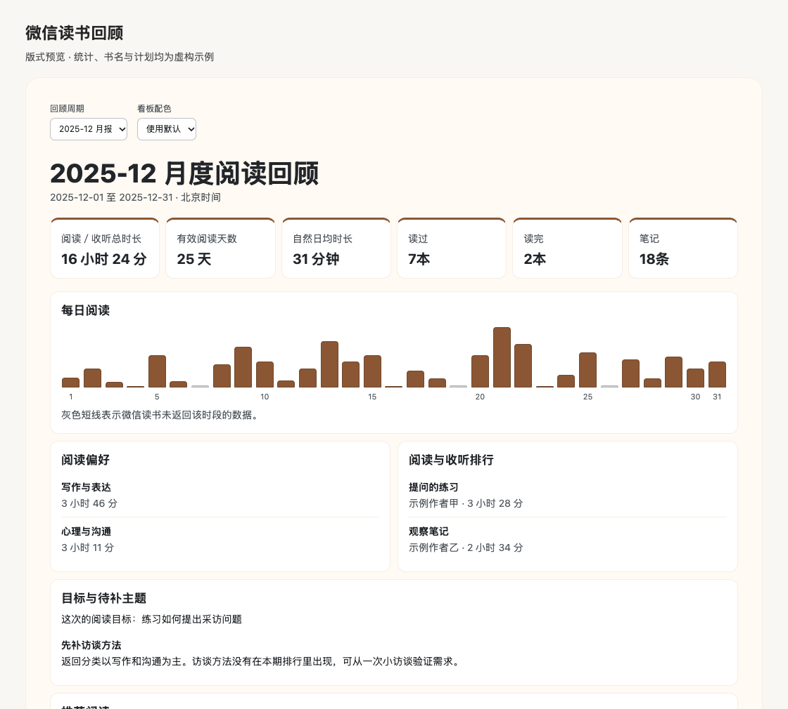

# WeRead Obsidian Review | 微信读书月报与年度总结

把微信读书（WeRead）的阅读统计做成 Obsidian 月报、年报和可换色的阅读看板。结合你的学习目标，标出值得补的阅读主题，推荐经微信读书书城核实的书，并安排未来 30 天的阅读计划。

**WeRead Obsidian Review** is an Agent Skill for monthly and annual WeChat Reading reports, an Obsidian reading dashboard, goal-based book recommendations, and a 30-day reading plan. The Skill ID is `ly-weread-review`. It uses the official WeRead Agent API and saves reports as local Markdown.

**LY Skills by Leah Yuan · 元元 Leah**

[下载 Skill ZIP](https://github.com/yuanyuanleah/weread-obsidian-review/releases/latest/download/ly-weread-review.zip) · [查看版本](https://github.com/yuanyuanleah/weread-obsidian-review/releases) · [免登录体验](#免登录体验)



## 一句话开始

> 做上个月的微信读书回顾，存到我的 Obsidian 库，给我 30 天阅读计划，用抹茶奶油配色。

> 做 2025 年的微信读书年度总结。我想学习访谈，看看阅读主题有什么可以补，给我几本微信读书上能查到的书。

也可以只搭看板、只换色，或在支持定时任务的客户端说「每月 1 日上午 9 点生成上一个月的读书总结和未来 30 天计划」。定时运行需要你的客户端支持，并能访问本机库和微信读书 API。

| 你想做什么 | 会得到什么 |
|---|---|
| 月报或年报 | 阅读与收听时长、有效阅读天数、阅读偏好与排行，按月或年进入同一看板 |
| 按目标补阅读 | 用现有统计说明哪些主题值得探索，核实候选书，给出推荐理由和起读动作 |
| 把总结变成行动 | 月报默认附 30 天计划，每段有行动和一个可检查的小产出 |
| 自定义 Obsidian 展示 | 切换报告周期和七套配色，也可以自选颜色 |
| 更新同一期 | 保留手写复盘、仍适用的计划勾选和历史版本 |

## 安装

1. **安装 Skill。** 在支持本地 Agent Skills 的客户端下载并解压 [ly-weread-review.zip](https://github.com/yuanyuanleah/weread-obsidian-review/releases/latest/download/ly-weread-review.zip)，导入完整的 `ly-weread-review` 文件夹。保留其中的 `SKILL.md`、`scripts/`、`assets/` 和 `references/`。Codex 也可在需要的项目根目录执行：

   ```bash
   npx skills add yuanyuanleah/weread-obsidian-review --skill ly-weread-review --agent codex
   ```

2. **连接微信读书。** 从 [微信读书官方 Skill 页面](https://weread.qq.com/r/weread-skills) 申请 API Key。在实际运行 Skill 的客户端环境里设置 `WEREAD_API_KEY`。Key 留在环境变量里。Python 需为 3.10 或更新版本。部分 Windows 环境如果缺少时区数据库，需要给该 Python 环境安装 `tzdata`。
3. **打开一个 Obsidian 库并发送上面的开始指令。** 客户端需要能运行 Python、访问微信读书接口并写入该库。默认在库里的 `微信读书回顾/` 创建 `00-阅读回顾.md` 和各期报告。互动看板使用 Dataview 的 **Enable JavaScript Queries**。没启用 Dataview 时，可在同一个目录打开各期 Markdown。

| 环境 | 安装方式和验证范围 |
|---|---|
| Codex | 支持工作区技能安装路径。使用合成数据验收脚本、报告和看板 |
| Claude Code | 可通过 [skills CLI](https://github.com/vercel-labs/skills) 选择对应 Agent 安装，实际客户端待验证 |
| WorkBuddy 和其他客户端 | 可尝试导入完整目录，需要本地 Python、环境变量、网络和 Vault 写入能力，实际客户端待验证 |
| Obsidian | 用于查看 Markdown 和 Dataview 看板，微信读书接口调用由 Skill 执行 |

## 免登录体验

下载仓库源码，在仓库根目录运行以下命令。用的是随仓库提供的虚构数据，生成独立的 `demo-vault`。

```bash
python3 -c "from pathlib import Path; Path('demo-vault/.obsidian').mkdir(parents=True, exist_ok=True)"
python3 ly-weread-review/scripts/review.py render --vault demo-vault --report examples/month.json --insights examples/insights.json --catalog examples/catalog.json --plan-start 2026-01-05
python3 ly-weread-review/scripts/review.py render --vault demo-vault --report examples/year.json
```

在 Obsidian 打开 `demo-vault` 作为库，再打开 `微信读书回顾/00-阅读回顾.md`。带 Dataview 的浏览器模拟交互已经过测试，真实微信读书账号和客户端内定时任务尚待实测。

## 常见问题

**微信读书的划线和笔记会被同步吗？** 这个 Skill 生成阅读报告。接口返回笔记条数时会展示数量，笔记正文和划线原文留在微信读书。需要同步原文可参考 [Obsidian WeRead Plugin](https://github.com/zhaohongxuan/obsidian-weread-plugin)。

**阅读盲区是怎么判断的？** 按你明确给出的目标，对照本期返回的分类和阅读排行。微信读书的排行有展示门槛，报告会区分「本期没有显示」和有证据的观察。书名和作者从微信读书书城核实。

**报告和 API Key 去哪里？** 报告写入你选择的本地库，标为私密。API Key 只从执行环境读入。搜书请求经微信读书官方接口发送关键词和必要的搜索背景。有关统计与执行参数见 [数据与执行](ly-weread-review/references/workflow.md)。

**如何定时或更换颜色？** 配色可在面板上直接换，也可以在生成时指定。每月复盘依赖 [客户端调度流程](ly-weread-review/references/schedule.md)。

## 来源与版本

作者 [Leah Yuan（元元 Leah）](https://github.com/yuanyuanleah) · LY Skills。报告使用 [腾讯微信读书 Agent API](https://github.com/Tencent/WeChatReading) 的阅读统计与书城搜索。互动展示使用 [Obsidian Dataview](https://github.com/blacksmithgu/obsidian-dataview)。

版本记录见 [CHANGELOG](CHANGELOG.md)。Copyright © 2026 Leah Yuan.
